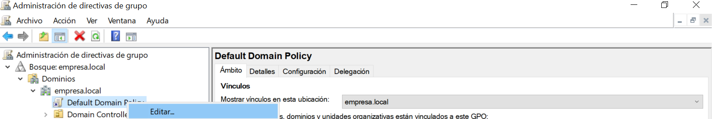
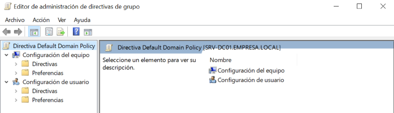
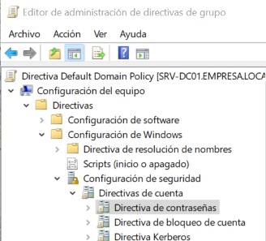
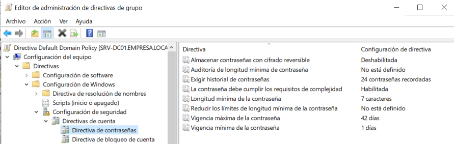
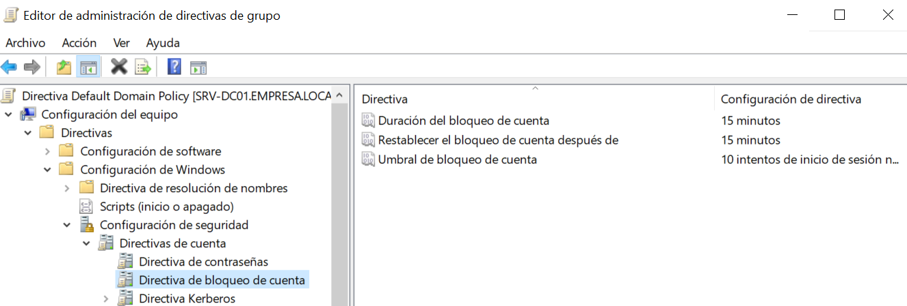

# Práctica 1 – Protección de las cuentas de Active Directory

## 1. Contexto empresarial

El departamento de Informática ha detectado que los empleados pueden utilizar contraseñas débiles y que es necesario revisar las restricciones ante intentos fallidos de autenticación.

## 2. Objetivo

Revisar y reforzar la política de contraseñas y de bloqueo de cuentas del dominio `empresa.local` para reducir el riesgo de accesos no autorizados.

## 3. Entorno y herramientas

- Windows Server 2022 (`SRV-DC01`).
- Active Directory Domain Services (AD DS).
- Administración de directivas de grupo (GPMC).
- Dominio `empresa.local`.
- Windows 11 (cliente previsto para la validación).
- VMware Workstation.

## 4. Requisitos de seguridad

| Parámetro | Valor requerido |
|---|---|
| Longitud mínima de contraseña | 14 caracteres |
| Requisitos de complejidad | Habilitados |
| Historial de contraseñas | 24 contraseñas |
| Umbral de bloqueo de cuenta | 10 intentos fallidos |
| Duración del bloqueo | 15 minutos |
| Restablecimiento del contador de intentos fallidos | 15 minutos |

## 5. Implementación

### 5.1. Acceso a la política de seguridad del dominio

Desde la herramienta **Administración de directivas de grupo**, se despliega el bosque y se selecciona el dominio `empresa.local`. A continuación, se hace clic con el botón derecho sobre **Default Domain Policy** y se selecciona **Editar**.

*Figura 1. Acceso a la edición de la directiva predeterminada del dominio.*

Se abre el Editor de administración de directivas de grupo. Las políticas de cuenta se encuentran en el apartado de configuración del equipo.

*Figura 2. Editor de la directiva de grupo del dominio.*

### 5.2. Localización de las directivas de cuenta

Se navega por la siguiente ruta:

`Configuración del equipo > Directivas > Configuración de Windows > Configuración de seguridad > Directivas de cuenta`

En este apartado se encuentran la **Directiva de contraseñas** y la **Directiva de bloqueo de cuenta**.

*Figura 3. Localización de las directivas de cuenta.*

### 5.3. Revisión de la política de contraseñas

Se selecciona **Directiva de contraseñas** y se revisan los valores existentes. La longitud mínima es de 7 caracteres, mientras que los requisitos de complejidad ya están habilitados y el historial está configurado en 24 contraseñas.

*Figura 4. Configuración observada antes de acreditar el cambio de longitud mínima.*

| Parámetro | Valor observado | Valor requerido | Estado |
|---|---|---|---|
| Longitud mínima | 7 caracteres | 14 caracteres | Pendiente de acreditar |
| Complejidad | Habilitada | Habilitada | Conforme |
| Historial | 24 contraseñas | 24 contraseñas | Conforme |

### 5.4. Revisión de la política de bloqueo de cuentas

Se selecciona **Directiva de bloqueo de cuenta** y se comprueban los parámetros relacionados con los intentos fallidos de autenticación.

*Figura 5. Valores observados en la directiva de bloqueo de cuenta.*

| Parámetro | Valor observado | Valor requerido | Estado |
|---|---|---|---|
| Umbral de bloqueo | 10 intentos fallidos | 10 intentos fallidos | Conforme |
| Duración del bloqueo | 15 minutos | 15 minutos | Conforme |
| Restablecimiento del contador | 15 minutos | 15 minutos | Conforme |

## 6. Riesgos mitigados

| Medida | Riesgo que ayuda a reducir |
|---|---|
| Longitud mínima y complejidad | Uso de contraseñas débiles y adivinación de credenciales |
| Historial de contraseñas | Reutilización de contraseñas anteriores |
| Umbral y duración del bloqueo | Intentos repetidos de autenticación |
| Restablecimiento del contador | Acumulación indefinida de errores de autenticación |

