# Práctica 02 — Aplicación del principio de mínimo privilegio

## 1. Contexto empresarial

Durante una auditoría de seguridad se ha detectado que algunos empleados podrían disponer de privilegios administrativos innecesarios para desempeñar sus funciones. Esta situación aumenta el riesgo de modificaciones no autorizadas y de abuso de privilegios.

## 2. Objetivo

Revisar la pertenencia a grupos de seguridad de los usuarios del dominio `empresa.local`, simular una asignación excesiva de privilegios y corregirla aplicando el principio de mínimo privilegio. Comprobar que la cuenta de prueba conserva sus capacidades ordinarias sin poder elevar privilegios administrativos con sus propias credenciales.

## 3. Entorno y herramientas

- Windows Server 2022 (`SRV-DC01`).
- Active Directory Domain Services (AD DS).
- Usuarios y equipos de Active Directory (ADUC).
- Dominio `empresa.local`.
- Windows 11 unido al dominio.
- Control de cuentas de usuario (UAC).
- Windows PowerShell 5.1.
- VMware Workstation.

## 4. Requisitos de seguridad

| Requisito | Descripción |
|---|---|
| Identificación de usuarios privilegiados | Identificar cuentas con privilegios administrativos en los grupos revisados. |
| Revisión de Domain Admins | Consultar los miembros del grupo de administradores del dominio. |
| Auditoría de grupos de seguridad | Revisar la pertenencia de los usuarios a los grupos de seguridad. |
| Retirada de privilegios innecesarios | Eliminar los privilegios administrativos innecesarios de una cuenta de prueba. |
| Validación de permisos | Comprobar que el usuario puede realizar tareas ordinarias. |
| Restricción de operaciones administrativas | Verificar que el usuario no puede elevar privilegios con sus propias credenciales. |

## 5. Implementación

### 5.1. Auditoría del grupo de administradores del dominio

Desde el Administrador del servidor se accede a **Herramientas > Usuarios y equipos de Active Directory**. Se despliega el dominio `empresa.local`, se selecciona el contenedor `Users` y se localiza el grupo **Admins. del dominio** (Domain Admins).

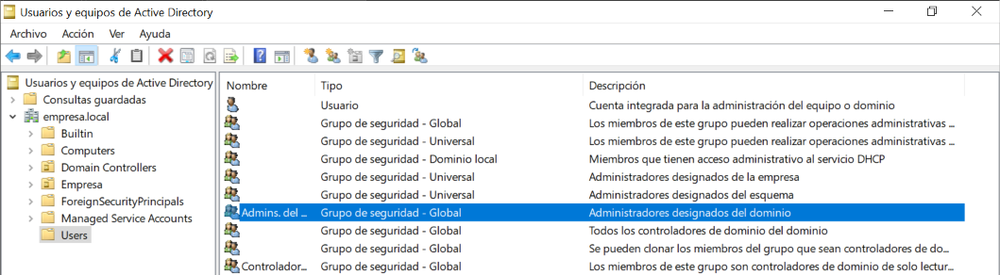

*Figura 1. Localización del grupo Admins. del dominio.*

Se abren sus propiedades y se comprueba que es un grupo de seguridad de ámbito global.

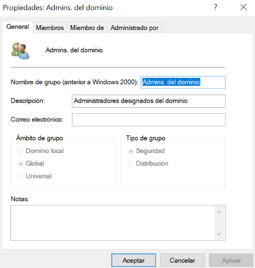

*Figura 2. Propiedades del grupo de administradores del dominio.*

En la pestaña **Miembros** se observa que la única cuenta directamente incluida es `Administrador`. No se identifican empleados ordinarios como miembros de este grupo.

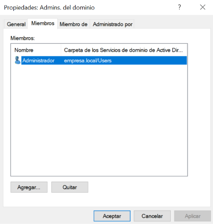

*Figura 3. Miembros iniciales de Admins. del dominio.*

### 5.2. Revisión del grupo Administradores

Se selecciona el contenedor `Builtin` y se localiza el grupo **Administradores**, de ámbito dominio local. La revisión de este grupo permite ampliar la auditoría más allá de Domain Admins.

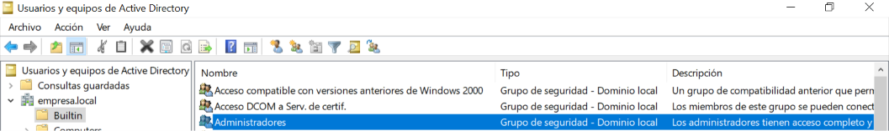

*Figura 4. Localización del grupo Administradores en Builtin.*

En la pestaña **Miembros** se observa la cuenta Administrador y dos grupos de seguridad, uno de ellos Admins. del dominio. El otro nombre aparece truncado en la captura, por lo que no se identifica de forma concluyente. La pertenencia a grupos anidados requeriría una revisión adicional para una auditoría exhaustiva.

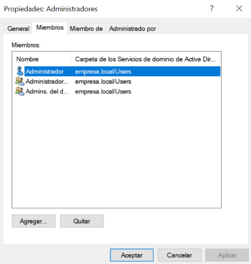

*Figura 5. Miembros del grupo Administradores.*

### 5.3. Revisión de los permisos de un empleado

Se despliega la unidad organizativa `Empresa` y se accede a `Administración`.

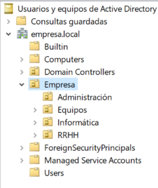

*Figura 6. Estructura de unidades organizativas del dominio.*

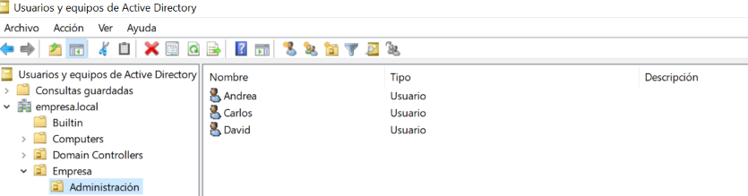

*Figura 7. Usuarios de la unidad organizativa Administración.*

Se abren las propiedades de Carlos y se selecciona la pestaña **Miembro de**. Se observa únicamente su pertenencia directa a Usuarios del dominio. No se detectan asignaciones administrativas directas en los grupos mostrados.

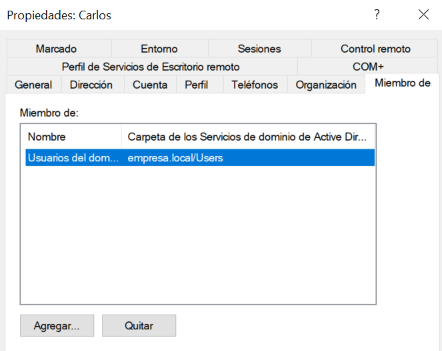

*Figura 8. Pertenencia inicial de Carlos a grupos de seguridad.*

### 5.4. Creación de una cuenta de prueba

Para reproducir una asignación incorrecta de privilegios sin modificar cuentas de empleados existentes, se crea el usuario `usuario_prueba` en la unidad organizativa Administración mediante **Nuevo > Usuario**. Se configura una contraseña de prueba que no se publica en el repositorio.

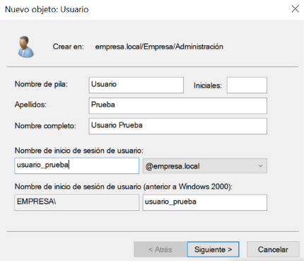

*Figura 9. Creación de la cuenta Usuario Prueba.*

Una vez creada la cuenta, se revisa la pestaña **Miembro de** y se comprueba que inicialmente pertenece a Usuarios del dominio.

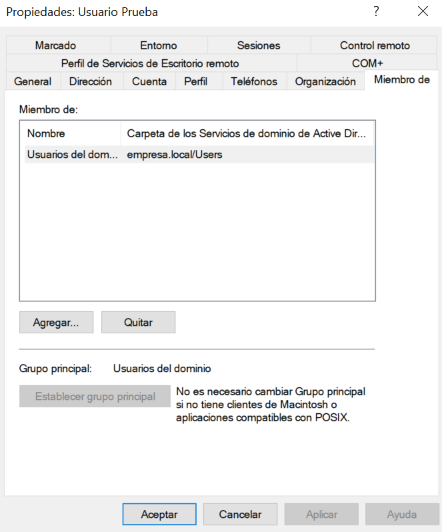

*Figura 10. Pertenencia inicial de la cuenta de prueba.*

### 5.5. Simulación de una asignación incorrecta de privilegios

Desde la pestaña **Miembro de**, se pulsa **Agregar**, se introduce `Admins. del dominio` y se selecciona **Comprobar nombres**. Se acepta la selección y se aplican los cambios. Esta asignación se realiza temporalmente en el laboratorio para simular una configuración insegura.

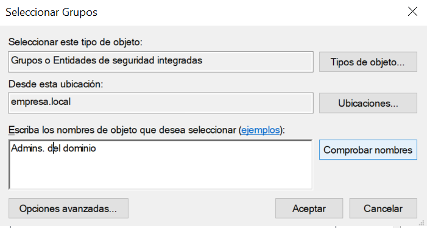

*Figura 11. Selección del grupo Admins. del dominio.*

La cuenta aparece como miembro de Usuarios del dominio y de Admins. del dominio. Esta última pertenencia supone un exceso de privilegios respecto a las tareas ordinarias previstas.

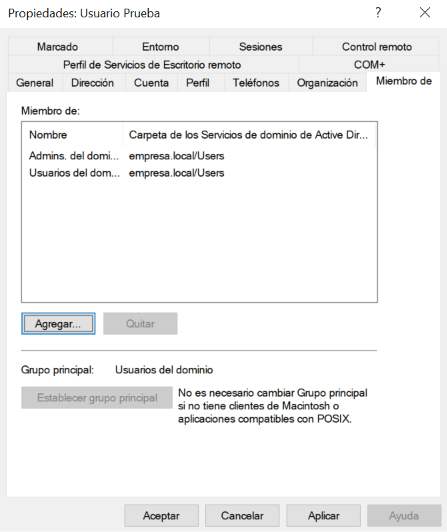

*Figura 12. Asignación simulada de privilegios administrativos.*

### 5.6. Aplicación del principio de mínimo privilegio

Se selecciona el grupo **Admins. del dominio** en las propiedades de la cuenta y se pulsa **Quitar**.

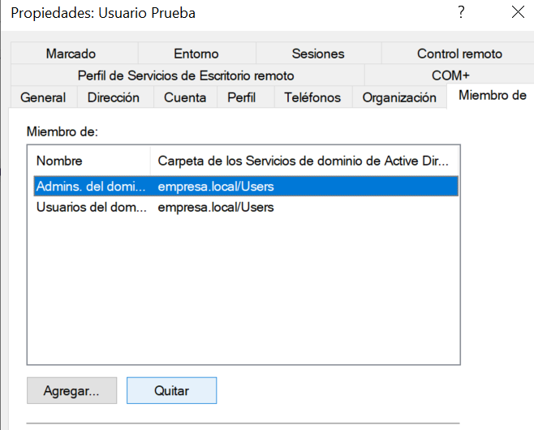

*Figura 13. Selección de los privilegios administrativos que deben retirarse.*

Se aplican los cambios y se conserva la pertenencia a Usuarios del dominio. La captura muestra la configuración resultante antes de cerrar la ventana de propiedades.

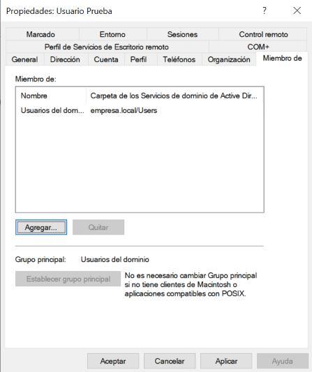

*Figura 14. Pertenencia de la cuenta tras retirar el grupo administrativo.*

### 5.7. Validación de tareas ordinarias en Windows 11

Se inicia sesión con `usuario_prueba@empresa.local`. Tras resolver la incidencia descrita en el apartado 7, se comprueba que el usuario puede acceder a su entorno de trabajo y crear una carpeta llamada `Prueba Minimo Privilegio` dentro de Descargas.

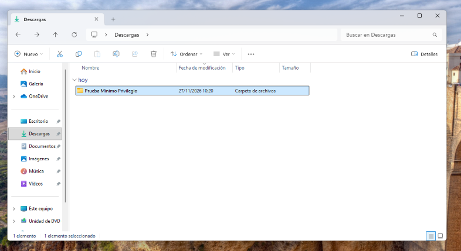

*Figura 15. Creación de una carpeta en el perfil del usuario.*

Dentro de la carpeta se crea el archivo `validacion.txt`. La captura acredita la creación del archivo, que aparece vacío (0 KB), pero no la edición de su contenido.

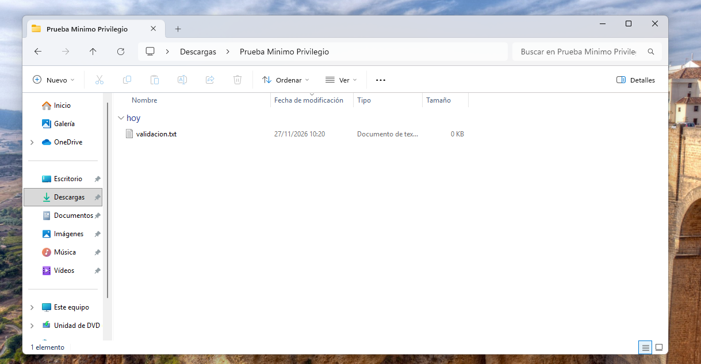

*Figura 16. Creación del archivo de texto de validación.*

### 5.8. Validación de la restricción de privilegios administrativos

Desde la sesión de la cuenta de prueba, se intenta abrir Windows PowerShell mediante **Ejecutar como administrador**. El Control de cuentas de usuario (UAC) solicita las credenciales de una cuenta administrativa.

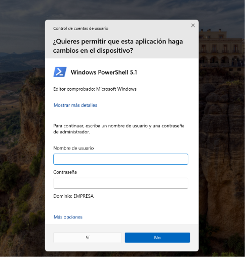

*Figura 17. Solicitud de credenciales administrativas mediante UAC.*

Al introducir las credenciales de la propia cuenta de prueba, Windows muestra el mensaje «La operación solicitada requiere elevación». Se cancela la operación sin proporcionar credenciales administrativas.

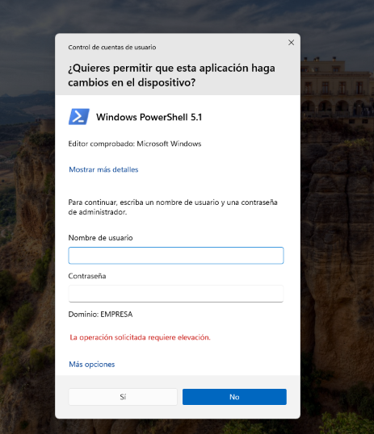

*Figura 18. Elevación administrativa no autorizada con la cuenta de prueba.*

La comprobación muestra que la cuenta no puede elevar PowerShell con sus propias credenciales en el equipo Windows 11. No constituye por sí sola una auditoría exhaustiva de todos los permisos del dominio.

| Comprobación | Resultado observado |
|---|---|
| Pertenencia a Admins. del dominio tras la retirada | No aparece en la lista de grupos de la cuenta |
| Inicio de sesión en Windows 11 | Correcto |
| Creación de carpeta y archivo | Permitida |
| Elevación de PowerShell con credenciales propias | No permitida |

## 6. Riesgos mitigados

| Medida | Riesgo que ayuda a reducir |
|---|---|
| Revisión de grupos privilegiados | Asignación inadvertida de permisos administrativos excesivos. |
| Retirada de la pertenencia a Domain Admins | Abuso de privilegios y modificaciones no autorizadas en el dominio. |
| Uso de cuentas ordinarias para tareas habituales | Impacto de una posible cuenta comprometida. |
| Restricción de la elevación administrativa | Ejecución no autorizada de procesos con privilegios elevados. |
| Validación posterior a los cambios | Interrupción de tareas ordinarias por una retirada incorrecta de permisos. |

## 7. Problemas encontrados

### 7.1. Pérdida de la relación de confianza entre Windows 11 y el dominio

Durante la validación, al intentar iniciar sesión con la cuenta de prueba, Windows mostró el error «Error en la relación de confianza entre la estación de trabajo y el dominio principal».


*Figura 19. Error de relación de confianza al iniciar sesión en Windows 11.*

Se eliminó y volvió a crear la cuenta de usuario de prueba, pero el error persistió. La incidencia afectaba al canal seguro del equipo con el dominio, no a la pertenencia del usuario a grupos administrativos. No se determinó la causa original de la ruptura del canal.

### 7.2. Diagnóstico

Se inició sesión con una cuenta local en Windows 11 y se ejecutó el siguiente comando en PowerShell:

```powershell
Test-ComputerSecureChannel -Verbose
```

Resultado observado:

```text
False
El canal seguro entre el equipo local y el dominio empresa.local está roto.
```

### 7.3. Reparación

El primer intento de reparación falló con un error de autenticación. Un intento posterior devolvió un error de acceso denegado porque se requerían derechos administrativos locales. Se abrió Windows PowerShell como administrador local y se ejecutó el comando indicando explícitamente el controlador de dominio y la cuenta administrativa del dominio:

```powershell
Test-ComputerSecureChannel -Repair -Server "SRV-DC01.empresa.local" -Credential (Get-Credential -UserName "EMPRESA\Administrador" -Message "Credenciales del dominio") -Verbose
```

Se introdujo la contraseña del administrador del dominio en la solicitud de credenciales, sin incluirla en el comando ni en la documentación.

Resultado observado:

```text
True
El canal seguro entre el equipo local y el dominio empresa.local se reparó correctamente.
```

### 7.4. Verificación de la solución

Se volvió a ejecutar:

```powershell
Test-ComputerSecureChannel -Verbose
```

Resultado observado:

```text
True
El canal seguro entre el equipo local y el dominio empresa.local está en buen estado.
```

Posteriormente se consiguió iniciar sesión con `usuario_prueba` y continuar con las pruebas de mínimo privilegio, sin necesidad de sacar el equipo del dominio ni volver a unirlo.
