# Práctica 04 — Securización del acceso remoto

## 1. Contexto empresarial

La empresa utiliza el servicio de Escritorio remoto (RDP) para facilitar la administración de sus servidores corporativos.

El departamento de Seguridad necesita garantizar que únicamente los usuarios y equipos autorizados puedan establecer conexiones remotas con el servidor, reduciendo el riesgo de accesos no autorizados y posibles ataques contra este servicio.

## 2. Objetivo

Revisar y reforzar la configuración de seguridad del servicio de Escritorio remoto (RDP) en Windows Server 2022.

Se pretende restringir el acceso remoto a los administradores y equipos autorizados, reforzar los mecanismos de autenticación y reducir la superficie de ataque mediante la configuración del firewall.

## 3. Entorno y herramientas

- Windows Server 2022 (`SRV-DC01`).
- Active Directory Domain Services (AD DS).
- Usuarios y equipos de Active Directory.
- Administración de directivas de grupo (GPO), como parte del entorno; la auditoría se realizó mediante la Directiva de seguridad local.
- Firewall de Windows Defender con seguridad avanzada.
- Escritorio remoto (RDP).
- Autenticación a nivel de red (NLA).
- Dominio `empresa.local`.
- Windows 11.
- Ubuntu 22.04 (cliente no autorizado).
- VMware Workstation.
- PowerShell, `ping` y Netcat (`nc`).

### Topología de la prueba

| Equipo | IP en red NAT | Función |
|---|---|---|
| SRV-DC01 | `192.168.96.164` | Servidor RDP |
| Windows 11 | `192.168.96.131` | Cliente autorizado |
| Ubuntu | `192.168.96.156` | Cliente no autorizado |

El servidor también dispone de la interfaz LAN `192.168.244.10`, y Ubuntu de `192.168.244.60`. Las pruebas RDP se realizaron en la red NAT `192.168.96.0/24`.

## 4. Requisitos de seguridad

| Requisito | Descripción |
|---|---|
| Auditoría de usuarios autorizados | Identificar los usuarios y grupos que disponen de permisos para establecer conexiones mediante Escritorio remoto. |
| Revisión de privilegios | Comprobar que únicamente las cuentas administrativas autorizadas disponen de acceso remoto al servidor. |
| Autenticación a nivel de red | Habilitar la autenticación a nivel de red (NLA) para exigir la autenticación antes de establecer una sesión remota. |
| Auditoría del firewall | Revisar las reglas de entrada relacionadas con el servicio de Escritorio remoto y el puerto 3389. |
| Restricción de conexiones | Configurar el firewall para permitir conexiones RDP únicamente desde los equipos o direcciones IP autorizados. |
| Validación del acceso autorizado | Comprobar que una cuenta administrativa autorizada puede establecer una conexión remota desde un equipo permitido. |
| Validación del acceso no autorizado | Verificar que una cuenta sin los permisos necesarios no puede establecer una sesión remota. |
| Validación de las restricciones de red | Comprobar que las conexiones procedentes de equipos no autorizados son bloqueadas por el firewall. |

## 5. Implementación

La práctica se desarrolló en dos fases: primero se auditó la configuración existente del controlador de dominio y después se reforzó el acceso remoto, comprobando que las medidas no impidieran la administración legítima del servidor. Todas las modificaciones se realizaron en `SRV-DC01`; Windows 11 y Ubuntu se utilizaron como clientes de prueba.

### 5.1. Auditoría de usuarios autorizados

Para determinar quién podía iniciar una sesión remota, se abrió la consola Usuarios y equipos de Active Directory (`dsa.msc`) en el servidor. Dentro del dominio `empresa.local`, se accedió al contenedor `Builtin`, donde se encuentran los grupos de seguridad integrados del dominio. El primer grupo inspeccionado fue Administradores.

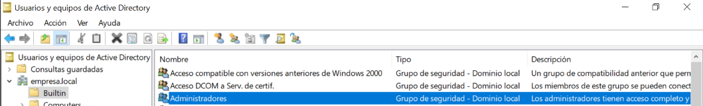

*Figura 1. Localización del grupo Administradores en Builtin.*
Al consultar sus propiedades, concretamente la pestaña Miembros, se identificaron tres entradas: la cuenta Administrador y dos grupos administrativos anidados. Por tanto, la auditoría no podía limitarse a contar usuarios directos: también era necesario comprobar quién pertenecía a esos grupos.

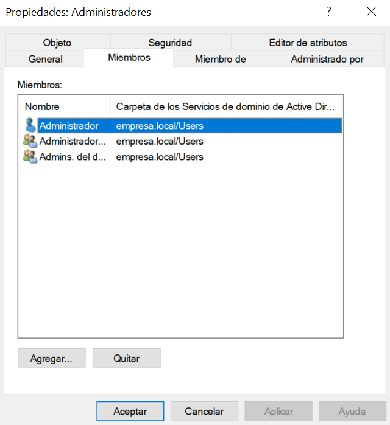

*Figura 2. Miembros directos del grupo Administradores.*
A continuación, se localizó Usuarios de escritorio remoto en el mismo contenedor y se abrieron sus propiedades. Este grupo permite agrupar cuentas destinadas al acceso remoto, aunque la pertenencia al grupo no garantiza por sí sola el derecho de iniciar sesión en un controlador de dominio.

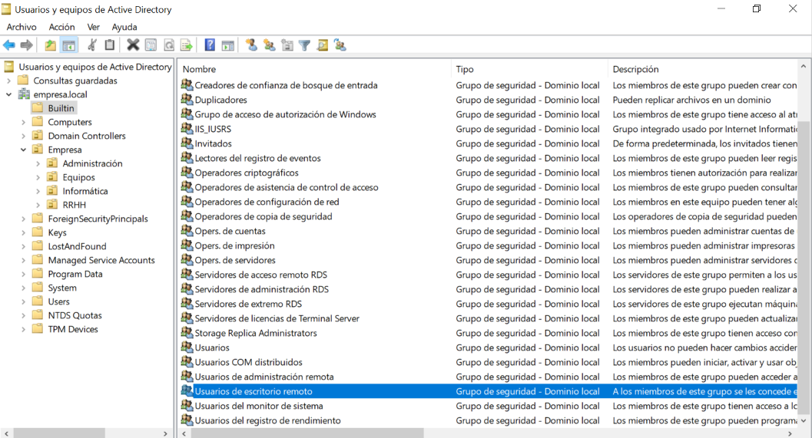

*Figura 3. Localización del grupo Usuarios de escritorio remoto.*

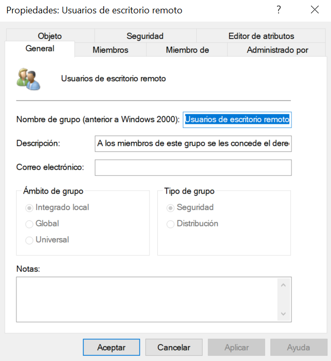

*Figura 4. Propiedades generales del grupo.*
La pestaña Miembros estaba vacía. No se encontraron, por tanto, cuentas añadidas directamente a este grupo.

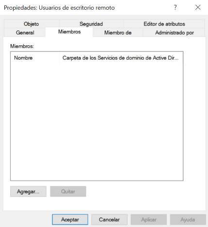

*Figura 5. Ausencia de miembros en Usuarios de escritorio remoto.*
Para comprobar qué grupos tenían realmente concedido el derecho de inicio de sesión remoto, se ejecutó `secpol.msc` y se accedió a **Directivas locales → Asignación de derechos de usuario**. En la directiva Permitir inicio de sesión a través de Servicios de Escritorio remoto figuraba exclusivamente Administradores.

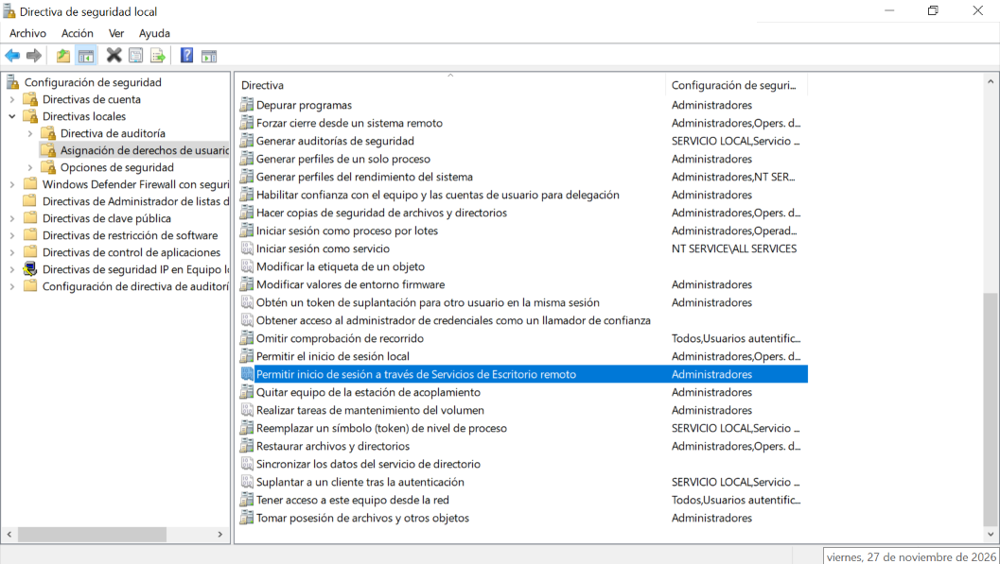

*Figura 6. Localización de la directiva de permiso RDP.*

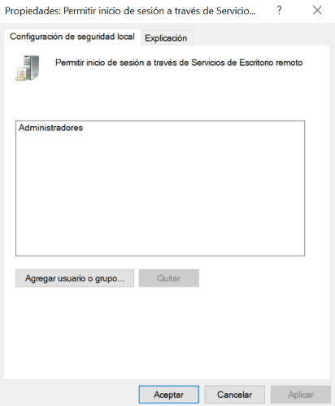

*Figura 7. Asignación exclusiva al grupo Administradores.*
También se revisó la directiva Denegar inicio de sesión a través de Servicios de Escritorio remoto, puesto que una denegación explícita prevalece sobre una concesión. Se comprobó que no tenía ninguna asignación. Esto no significa que cualquier usuario pueda acceder: quien carece del derecho de inicio de sesión sigue sin estar autorizado.

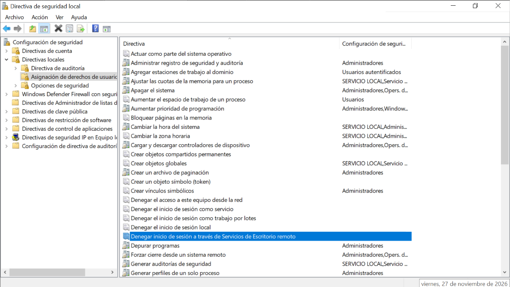

*Figura 8. Localización de la directiva de denegación.*

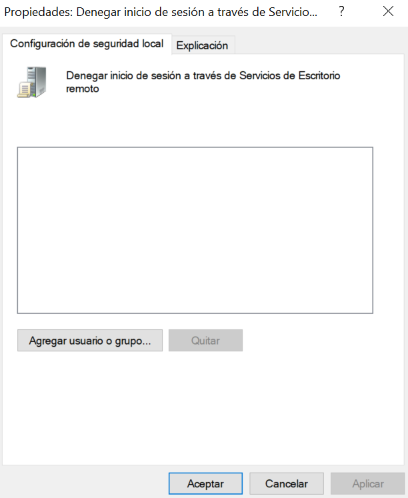

*Figura 9. Directiva de denegación sin asignaciones.*
La auditoría inicial mostró que el derecho RDP estaba restringido al grupo Administradores, sin necesidad de modificar estas directivas.

### 5.2. Revisión de privilegios administrativos

Una vez identificados los grupos con derecho de acceso, se revisaron los grupos anidados para descartar que algún empleado hubiera recibido privilegios indirectamente. En el contenedor `Users` se localizó Admins. del dominio y se consultaron sus miembros.

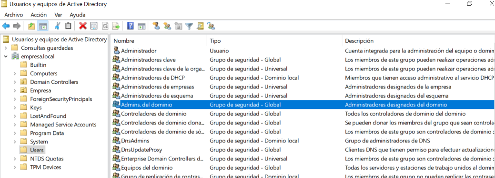

*Figura 10. Localización de Admins. del dominio.*

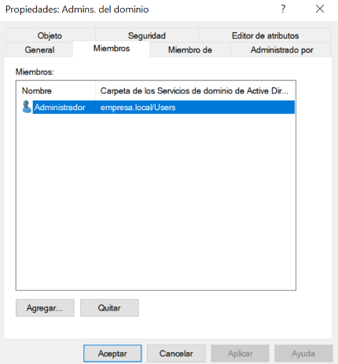

*Figura 11. Administrador como único miembro visible.*
El mismo procedimiento se realizó con Administradores de empresas. Este grupo también contenía únicamente la cuenta Administrador.

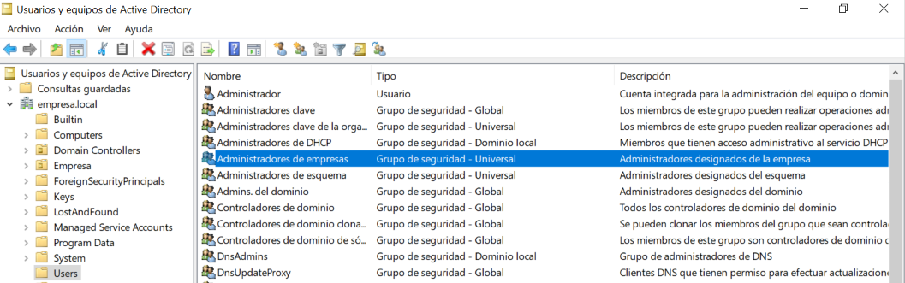

*Figura 12. Localización de Administradores de empresas.*

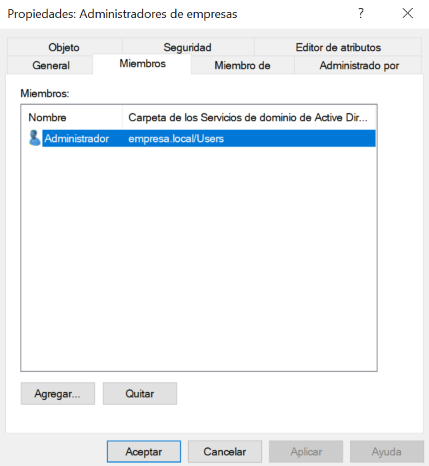

*Figura 13. Miembros de Administradores de empresas.*
Como no se detectaron cuentas de empleados en los grupos auditados, no fue necesario retirar ni conceder privilegios. Se conservó la configuración existente, respetando el principio de mínimo privilegio.

### 5.3. Habilitación de Escritorio remoto y NLA

Para revisar la configuración del servicio se ejecutó `SystemPropertiesRemote.exe` desde el servidor y se abrió la pestaña Acceso remoto.

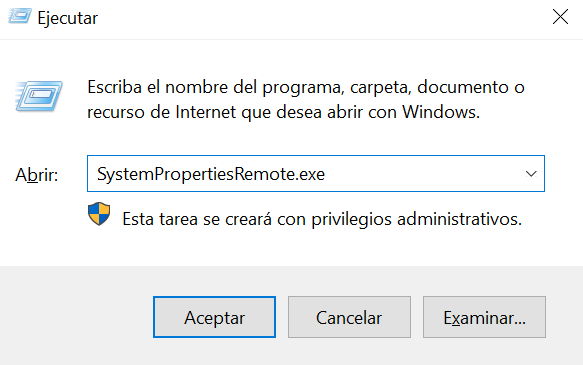

*Figura 14. Apertura de las propiedades de acceso remoto.*
Inicialmente, Escritorio remoto estaba deshabilitado. La opción de autenticación a nivel de red (NLA) aparecía marcada, pero inactiva debido a que las conexiones remotas no estaban permitidas.

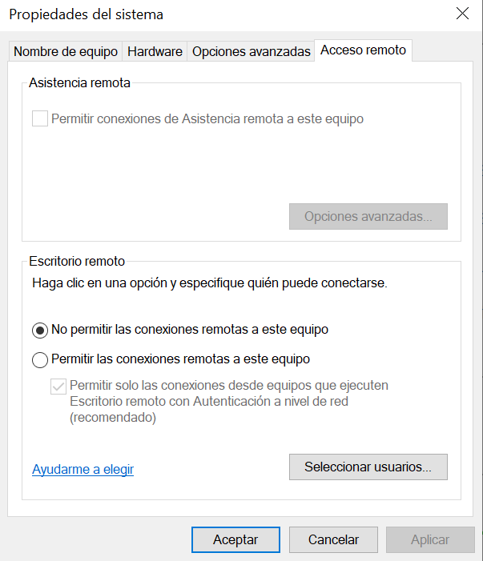

*Figura 15. Estado inicial del servicio RDP.*
Se habilitaron las conexiones remotas y se mantuvo seleccionada la opción que exige NLA. De esta manera, el usuario debe autenticarse antes de establecer una sesión de escritorio remoto, reduciendo la exposición del servicio frente a conexiones no autenticadas.

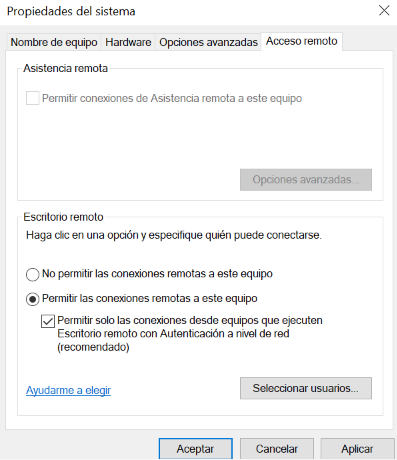

*Figura 16. Configuración de Escritorio remoto con NLA.*
Tras aplicar la configuración, se pasó a revisar las reglas del firewall asociadas al servicio.

### 5.4. Auditoría del firewall

Se ejecutó `wf.msc` en Windows Server y se accedió a Reglas de entrada. Se identificaron tres reglas habilitadas: Modo usuario TCP, Modo usuario UDP e Instantánea TCP. Las reglas WebSocket permanecían deshabilitadas.

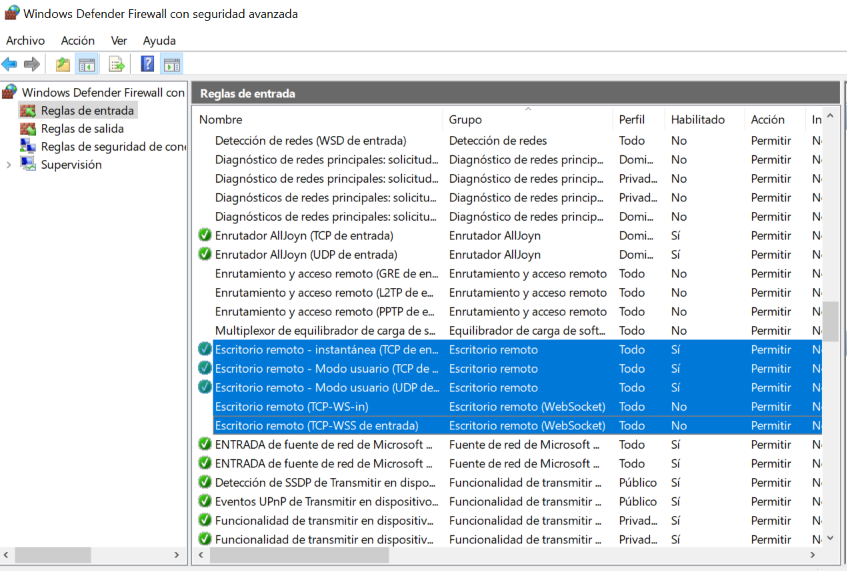

*Figura 17. Estado inicial de las reglas de Escritorio remoto.*
Se abrió la regla Modo usuario TCP para examinar el protocolo, el puerto local y el ámbito de las conexiones permitidas. La pestaña Protocolos y puertos confirmó que utilizaba TCP 3389.

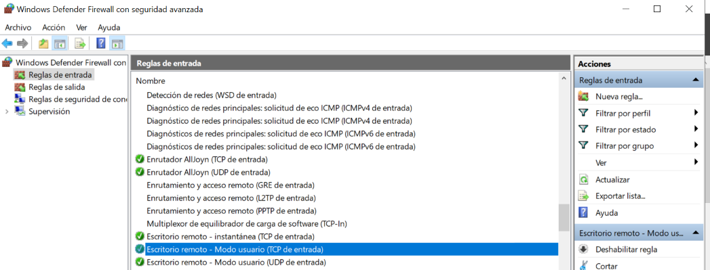

*Figura 18. Selección de la regla TCP.*

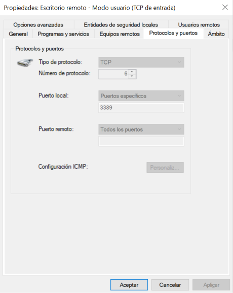

*Figura 19. Puerto local TCP 3389.*
Sin embargo, en Ámbito se comprobó que cualquier dirección IP remota podía coincidir con la regla. Esto ampliaba innecesariamente el conjunto de orígenes desde los que se podía intentar acceder al servicio.

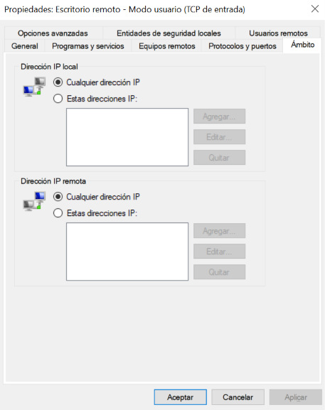

*Figura 20. Ámbito remoto inicial de TCP sin restricciones.*
La auditoría se repitió para UDP. Se confirmó que utilizaba igualmente el puerto 3389 y que tampoco tenía restricciones de origen.

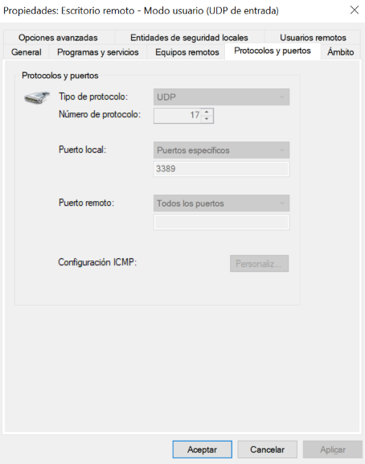

*Figura 21. Puerto local UDP 3389.*


*Figura 22. Ámbito remoto inicial de UDP.*
Por último, se examinó la regla Instantánea TCP, vinculada a la supervisión de sesiones remotas (Shadowing). Su filtro contemplaba todos los puertos TCP y cualquier IP remota; esto no significa que todos los servicios TCP quedaran abiertos, puesto que la regla está asociada a una funcionalidad concreta. Como dicha funcionalidad no era necesaria para el escenario planteado, se decidió deshabilitarla.

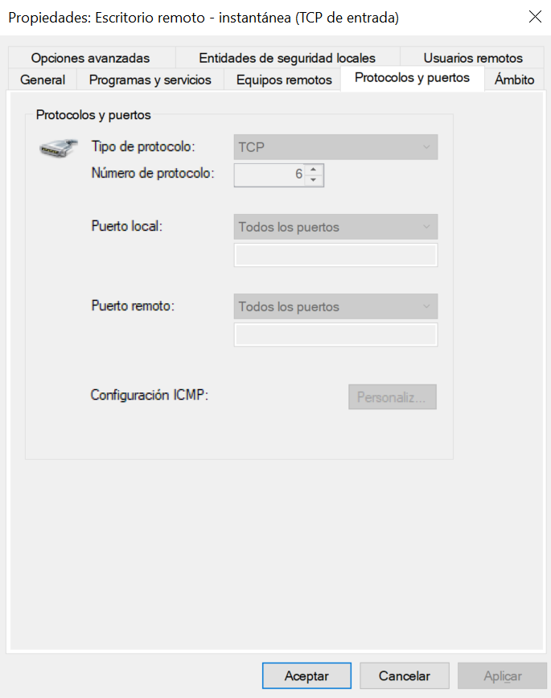

*Figura 23. Filtro de puertos de la regla Instantánea.*

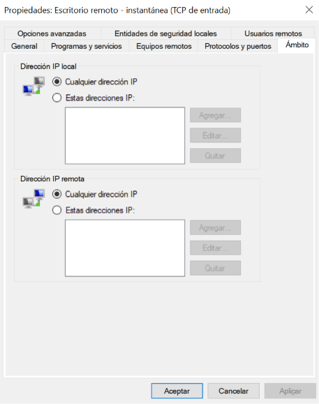

*Figura 24. Ámbito inicial de Instantánea.*

### 5.5. Restricción de conexiones por dirección IP

Antes de modificar las reglas, se identificaron las direcciones de red de los equipos mediante `ipconfig`. El servidor disponía de una interfaz LAN (`192.168.244.10`) y otra NAT (`192.168.96.164`). Windows 11 estaba conectado a la red NAT con la dirección `192.168.96.131`, por lo que se utilizó esta última como origen autorizado para las pruebas.

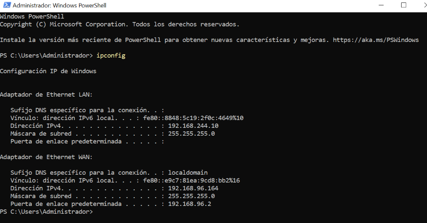

*Figura 25. Interfaces de red de SRV-DC01.*

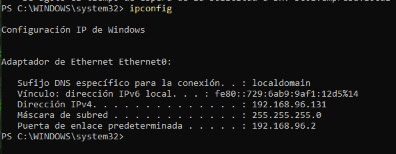

*Figura 26. Dirección IPv4 de Windows 11.*
Desde Windows 11 se comprobó que el puerto RDP era accesible antes de aplicar las restricciones:

```powershell
Test-NetConnection 192.168.96.164 -Port 3389
```

El resultado `TcpTestSucceeded : True` confirmó la conectividad TCP inicial y proporcionó una referencia para las pruebas posteriores.

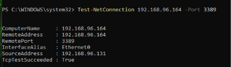

*Figura 27. Comprobación inicial de conectividad TCP.*
En el firewall del servidor se abrió la regla Modo usuario TCP. En la pestaña Ámbito, dentro de Dirección IP remota, se sustituyó Cualquier dirección IP por Estas direcciones IP y se añadió exclusivamente `192.168.96.131`. No se modificó el ámbito local.

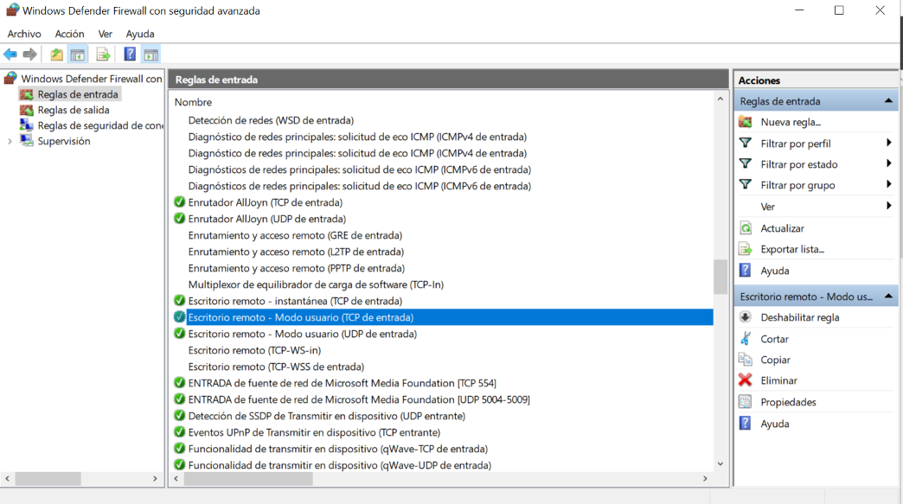

*Figura 28. Selección de Modo usuario TCP.*

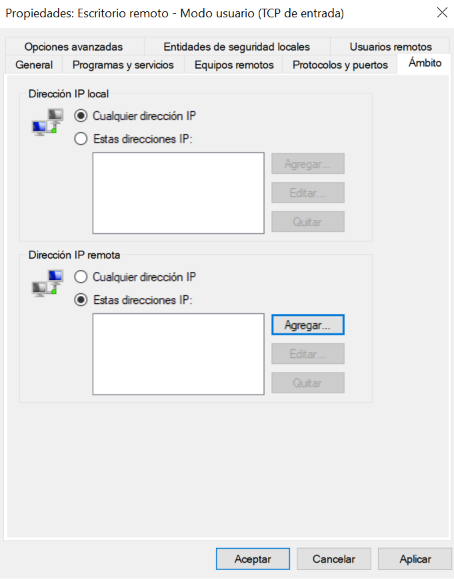

*Figura 29. Edición de las direcciones remotas permitidas.*

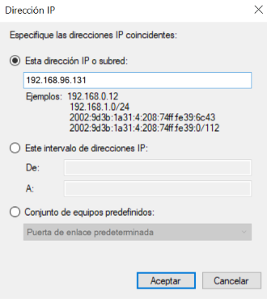

*Figura 30. Introducción de la IP autorizada para TCP.*
Para evitar que UDP conservara un ámbito más amplio que TCP, se aplicó exactamente la misma restricción a Modo usuario UDP.

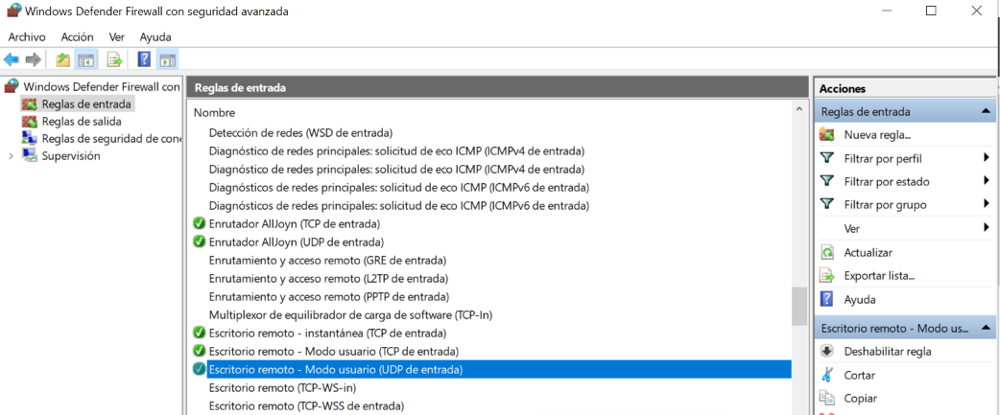

*Figura 31. Selección de Modo usuario UDP.*

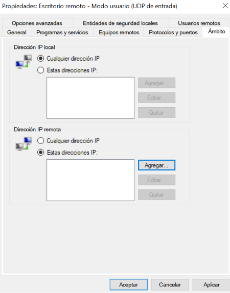

*Figura 32. Edición del ámbito remoto UDP.*

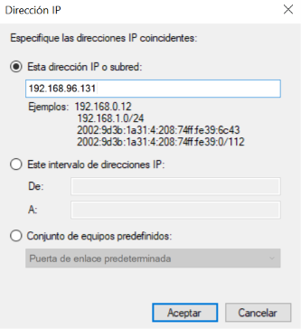

*Figura 33. Introducción de la IP autorizada para UDP.*
A continuación, se deshabilitó la regla Instantánea TCP, sin eliminarla, para poder recuperarla si en el futuro fuera necesaria. La desaparición del indicador verde y la aparición de la opción Habilitar regla confirmaron el cambio. Su ámbito original quedó intacto porque la regla ya no estaba activa.

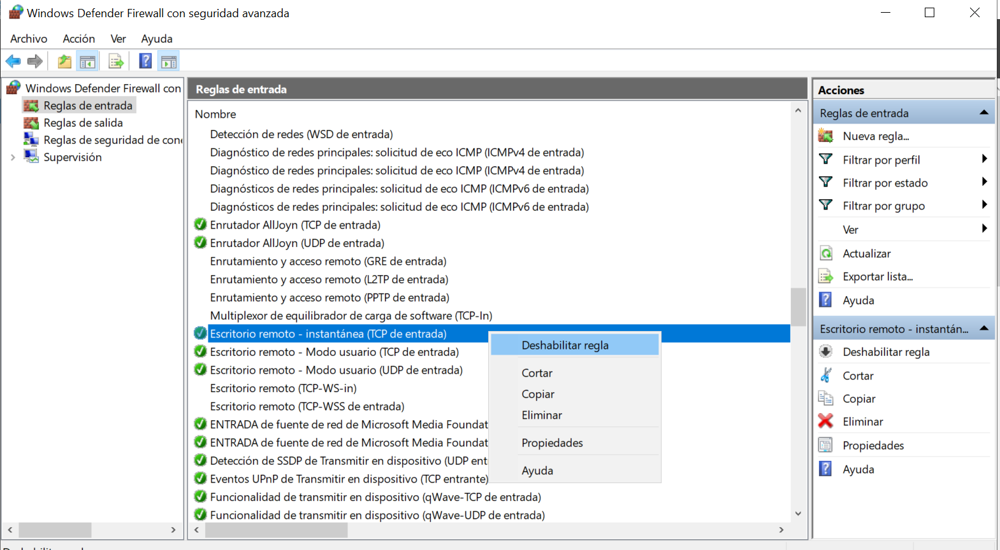

*Figura 34. Acción de deshabilitar Instantánea.*

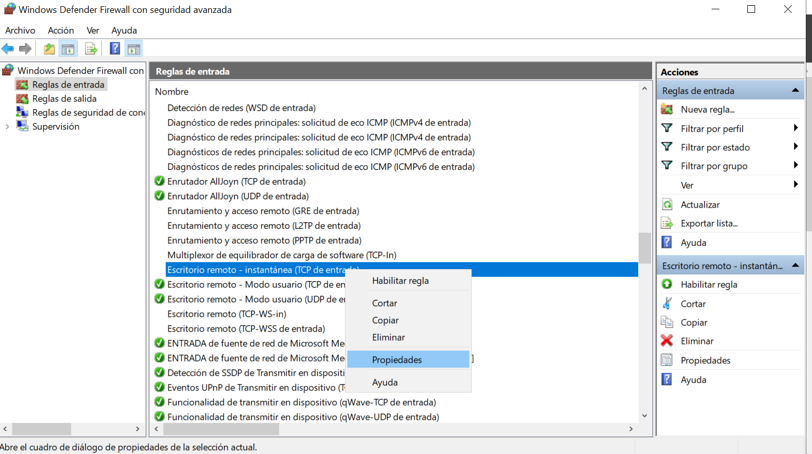

*Figura 35. Confirmación de la regla deshabilitada.*

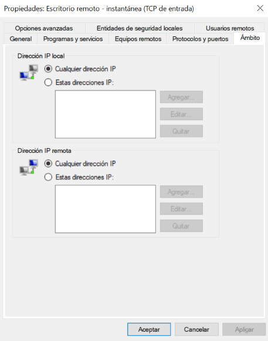

*Figura 36. Ámbito conservado de la regla inactiva.*
Finalmente, se volvieron a abrir las propiedades de ambas reglas de modo usuario para comprobar que los cambios se habían guardado. TCP y UDP seguían habilitadas y mostraban únicamente la IP remota autorizada.

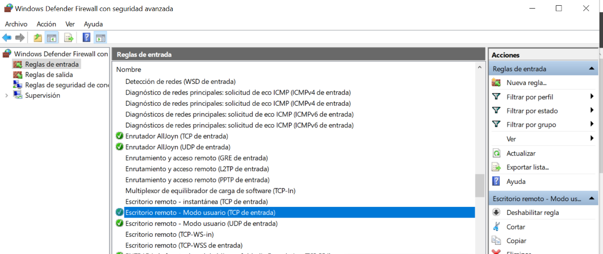

*Figura 37. Regla TCP habilitada.*

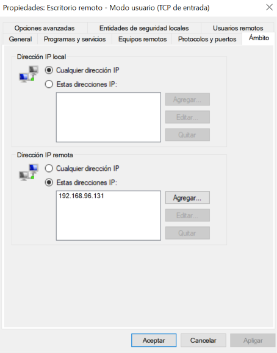

*Figura 38. Ámbito TCP definitivo.*

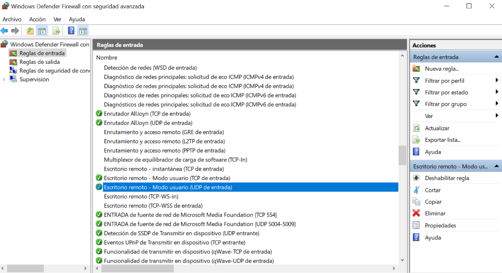

*Figura 39. Regla UDP habilitada.*

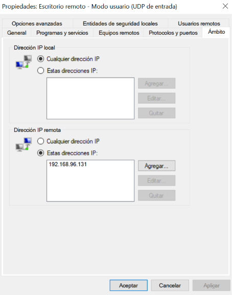

*Figura 40. Ámbito UDP definitivo.*

| Regla | Estado final | Origen autorizado |
|---|---|---|
| TCP 3389 | Habilitada | `192.168.96.131` |
| UDP 3389 | Habilitada | `192.168.96.131` |
| Instantánea TCP | Deshabilitada | No aplica |

### 5.6. Validación del acceso autorizado

Una vez reforzado el firewall, se comprobó que las medidas no impedían la administración legítima. Desde Windows 11 se abrió el cliente de Escritorio remoto (`mstsc`) y se introdujo la IP NAT del servidor, `192.168.96.164`.

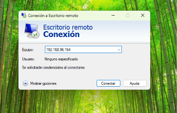

*Figura 41. Conexión iniciada desde Windows 11.*
Se seleccionó la opción de utilizar otra cuenta y se introdujeron las credenciales de `EMPRESA\Administrador`, perteneciente al grupo que dispone del derecho de inicio de sesión remoto.

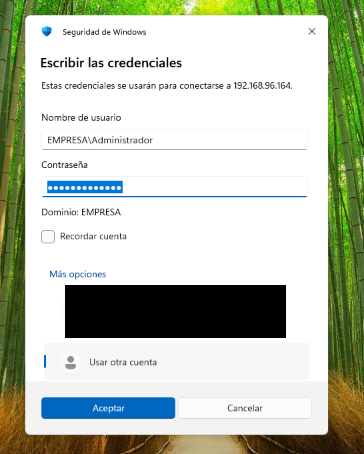

*Figura 42. Autenticación con la cuenta administrativa del dominio.*
La conexión se estableció correctamente y se visualizó el escritorio de Windows Server dentro de la máquina virtual Windows 11. La barra de conexión remota identificaba la IP del servidor, lo que constituye evidencia de que tanto el origen permitido como la cuenta administrativa podían acceder después de aplicar las restricciones.

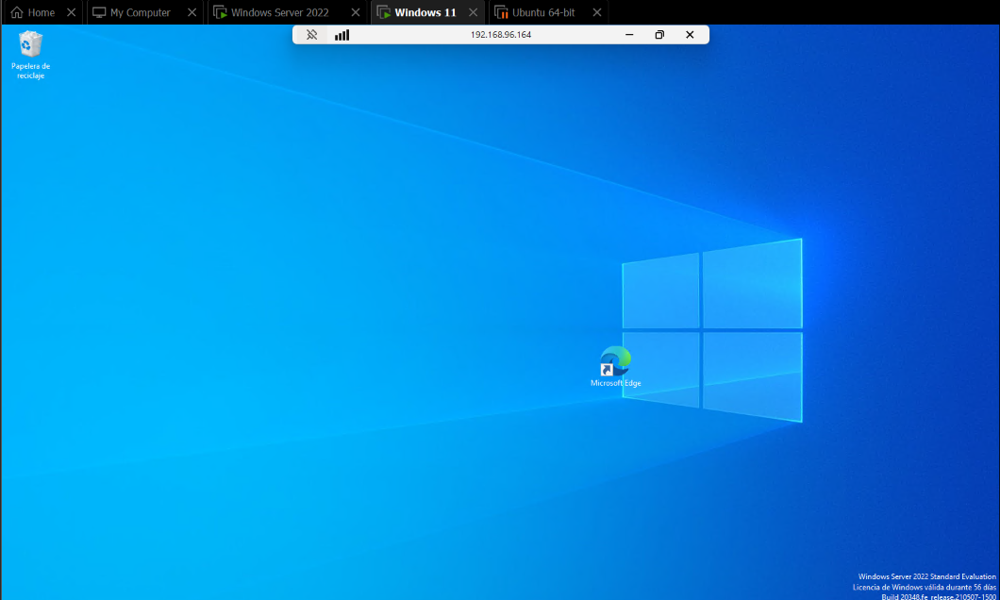

*Figura 43. Sesión RDP establecida correctamente.*

### 5.7. Validación del acceso no autorizado

Para comprobar que el filtrado por IP no sustituía el control de permisos, se repitió la conexión desde el mismo Windows 11, manteniendo el origen autorizado pero cambiando la identidad del usuario. Se utilizaron las credenciales de `andrea_caminos@empresa.local`, una cuenta sin privilegios administrativos.

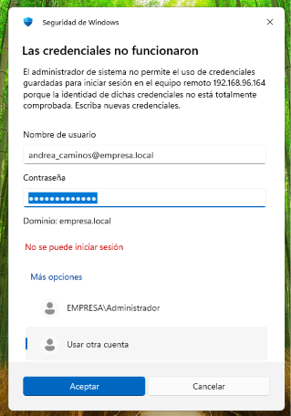

*Figura 44. Intento de autenticación con una cuenta no administrativa.*
El servidor rechazó el inicio de sesión e indicó expresamente que las cuentas de usuario no estaban autorizadas para el inicio remoto de sesión. El mensaje permitió distinguir un rechazo por permisos de un problema de conectividad: el cliente podía llegar al servicio, pero la identidad utilizada no tenía derecho a acceder.

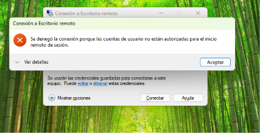

*Figura 45. Denegación explícita del inicio remoto de sesión.*

### 5.8. Validación de las restricciones de red

La última prueba se realizó desde Ubuntu, un equipo que no figuraba entre los orígenes autorizados. Mediante `ip a` se verificó que disponía de una interfaz LAN con IP `192.168.244.60` y otra NAT con IP `192.168.96.156`. Esta última pertenecía a la misma subred que el servidor y Windows 11, pero no coincidía con la dirección permitida por el firewall.

```bash
ip a
```

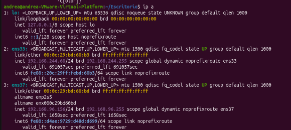

*Figura 46. Interfaces y direcciones IP de Ubuntu.*
Antes de probar RDP se comprobó la conectividad general mediante ICMP, para descartar que el equipo estuviera simplemente desconectado de la red.

```bash
ping -c 4 192.168.96.164
```

El servidor respondió a los cuatro paquetes enviados, con un 0 % de pérdidas. Existía, por tanto, comunicación de red entre ambos equipos.

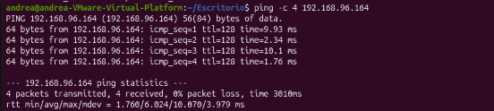

*Figura 47. Conectividad ICMP correcta desde Ubuntu.*
A continuación, se utilizó Netcat para intentar establecer una conexión TCP con el puerto 3389, sin necesidad de instalar un cliente gráfico RDP.

```bash
nc -zv -w 5 192.168.96.164 3389
```

La conexión terminó por tiempo de espera agotado. Al contrastar este resultado con la conectividad ICMP y la sesión RDP exitosa desde Windows 11, se obtuvo evidencia coherente con el filtrado por IP aplicado al servicio. No se recopilaron registros de descartes del firewall ni se comprobó UDP de forma independiente, por lo que la validación experimental se limita a TCP.


*Figura 48. Tiempo de espera agotado al conectar al puerto TCP 3389.*

### 5.9. Resultados finales

Las pruebas permitieron diferenciar los dos niveles de seguridad implementados: el control de identidad determina qué usuarios pueden iniciar sesión, mientras que el firewall limita los orígenes de red desde los que se puede alcanzar RDP.

| Origen | Prueba | Resultado |
|---|---|---|
| Windows 11 | RDP con Administrador | Acceso permitido |
| Windows 11 | RDP con usuario no administrativo | Acceso denegado por permisos |
| Ubuntu | Ping al servidor | Correcto |
| Ubuntu | TCP 3389 | Tiempo de espera agotado |
| Firewall | Restricción UDP 3389 | Configurada; sin prueba independiente |

Se abordaron los ocho requisitos de seguridad, con la limitación indicada para UDP. La autorización por IP es provisional y depende de que Windows 11 conserve la dirección NAT utilizada en el laboratorio; no se configuró una reserva DHCP durante esta práctica.

## 6. Riesgos mitigados

| Riesgo | Medida aplicada |
|---|---|
| Acceso remoto de usuarios sin autorización | Revisión de grupos y derechos de inicio de sesión; prueba de denegación |
| Privilegios administrativos innecesarios | Auditoría de miembros directos y grupos administrativos anidados |
| Exposición de sesiones antes de la autenticación | Exigencia de NLA |
| Intentos de conexión RDP desde orígenes no autorizados | Restricción de IP remota en TCP y UDP 3389 |
| Exposición innecesaria de la supervisión de sesiones | Deshabilitación de la regla de instantánea |

### Limitaciones y recomendaciones

- El filtrado por IP reduce la exposición, pero no autentica por sí mismo la identidad del dispositivo. Conviene utilizar una IP estable o una reserva DHCP y mantener controles de identidad adicionales.
- La prueba de red se centró en TCP; la configuración UDP fue inspeccionada, no validada experimentalmente.
- En producción, sería recomendable administrar el controlador de dominio desde una estación administrativa dedicada, evitar el uso cotidiano de la cuenta Administrador integrada y utilizar políticas centralizadas, registro de eventos y controles de acceso adecuados. No se implementaron esas medidas adicionales en esta práctica.

### Conclusión

Se reforzó el acceso remoto de SRV-DC01 mediante NLA, revisión de derechos administrativos y filtrado de las conexiones por IP. Las pruebas demostraron que la cuenta autorizada podía acceder desde Windows 11, que una cuenta sin privilegios recibía una denegación y que Ubuntu no podía alcanzar el puerto TCP de RDP pese a disponer de conectividad IP.
